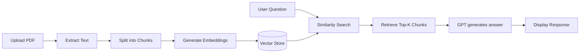

# PDF RAG Chatbot

A collection of **Retrieval-Augmented Generation (RAG)** chatbots built with [Streamlit](https://streamlit.io/), [LangChain](https://www.langchain.com/), and [OpenAI](https://openai.com/). Upload PDF documents, index them with vector embeddings, and ask natural-language questions—the app retrieves relevant passages and generates answers with GPT.

The project includes several iterations (`bot.py` through `bot5.py`) that explore different vector stores, PDF parsers, and UI features.

## Features

- **PDF upload & indexing** — Extract text from PDFs and store semantic embeddings for fast retrieval
- **Conversational Q&A** — Ask questions about uploaded documents with chat history
- **Multiple vector backends** — Local [ChromaDB](https://www.trychroma.com/) or cloud [Pinecone](https://www.pinecone.io/)
- **Predefined answers** — Hard-coded Q&A pairs for demo/testing (Pinecone versions)
- **Image extraction** — Pull embedded images from PDF pages (`bot5.py`)
- **Financial & tender document support** — Tested on earnings reports and construction tender PDFs

## Project Structure

```
Chatbot/
├── bot.py          # v1 — Chroma + PyPDFLoader (financial reports)
├── bot1.py         # v2 — Chroma + pdfplumber (multi-PDF upload)
├── bot2.py         # v3 — Pinecone + predefined Q&A + modal UI
├── bot4.py         # v4 — Pinecone + modern LangChain API
├── bot5.py         # v5 — Pinecone + PDF image extraction
├── .env.example    # Environment variable template (copy to .env)
├── requirements.txt
├── uploaded_files/ # Saved uploads (gitignored)
├── chroma_db/      # Local vector store (gitignored, auto-generated)
└── extracted_docs/ # Cached text extractions (gitignored)
```

## Bot Versions

| File     | Vector DB | PDF Parser  | Model      | Highlights                          |
|----------|-----------|-------------|------------|-------------------------------------|
| `bot.py` | Chroma    | PyPDFLoader | GPT-4      | Financial report analyzer           |
| `bot1.py`| Chroma    | pdfplumber  | GPT-4-turbo| Multi-file upload, sidebar UI       |
| `bot2.py`| Pinecone  | pdfplumber  | GPT-4o     | Predefined Q&A, answer reference modal |
| `bot4.py`| Pinecone  | pdfplumber  | GPT-4o     | Updated LangChain Runnable API      |
| `bot5.py`| Pinecone  | pdfplumber  | GPT-4      | Extracts & displays images from PDFs |

## Prerequisites

- Python 3.9+
- [OpenAI API key](https://platform.openai.com/api-keys)
- [Pinecone API key](https://www.pinecone.io/) — required for `bot2.py`, `bot4.py`, and `bot5.py` only

## Setup

1. **Clone the repository**

   ```bash
   git clone <your-repo-url>
   cd Chatbot
   ```

2. **Create a virtual environment**

   ```bash
   python -m venv venv
   venv\Scripts\activate        # Windows
   # source venv/bin/activate   # macOS / Linux
   ```

3. **Install dependencies**

   ```bash
   pip install -r requirements.txt
   ```

4. **Configure environment variables**

   ```bash
   copy .env.example .env         # Windows
   # cp .env.example .env       # macOS / Linux
   ```

   Edit `.env` and add your API keys:

   ```env
   OPENAI_API_KEY=your_openai_api_key
   PINECONE_API_KEY=your_pinecone_api_key
   PINECONE_ENVIRONMENT=us-east-1
   PINECONE_HOST=your_pinecone_index_host
   ```

   > **Note:** `bot.py` and `bot1.py` only require `OPENAI_API_KEY`.

## Usage

Run any bot with Streamlit:

```bash
streamlit run bot5.py
```

Replace `bot5.py` with the version you want to try. The app opens in your browser (default: `http://localhost:8501`).

### Typical workflow

1. Upload a PDF through the Streamlit UI
2. Wait for text extraction and indexing
3. Type a question in the input box
4. View the AI-generated answer (and source references where supported)

## How It Works



1. **Ingestion** — PDF text is extracted and split into overlapping chunks
2. **Embedding** — OpenAI `text-embedding-ada-002` converts chunks to vectors
3. **Storage** — Vectors are stored in Chroma (local) or Pinecone (cloud)
4. **Retrieval** — User queries are embedded and matched against stored chunks
5. **Generation** — Top matching chunks are sent as context to GPT for the final answer

## Environment Variables

| Variable              | Required for        | Description                    |
|-----------------------|---------------------|--------------------------------|
| `OPENAI_API_KEY`      | All bots            | OpenAI API key                 |
| `PINECONE_API_KEY`    | bot2, bot4, bot5    | Pinecone API key               |
| `PINECONE_ENVIRONMENT`| bot2, bot4, bot5    | Pinecone region (e.g. us-east-1) |
| `PINECONE_HOST`       | bot2, bot4, bot5    | Pinecone index host URL        |

## Security

- **Never commit `.env`** — it contains secret API keys
- Rotate keys immediately if they were ever exposed
- Large generated data (`chroma_db/`, uploads) is excluded via `.gitignore`

## Tech Stack

- **UI:** Streamlit
- **LLM / Embeddings:** OpenAI (GPT-4, GPT-4-turbo, GPT-4o, text-embedding-ada-002)
- **Orchestration:** LangChain
- **Vector stores:** ChromaDB, Pinecone, FAISS
- **PDF parsing:** PyPDFLoader, pdfplumber, Pillow (image extraction)

## License

MIT (or specify your preferred license)
